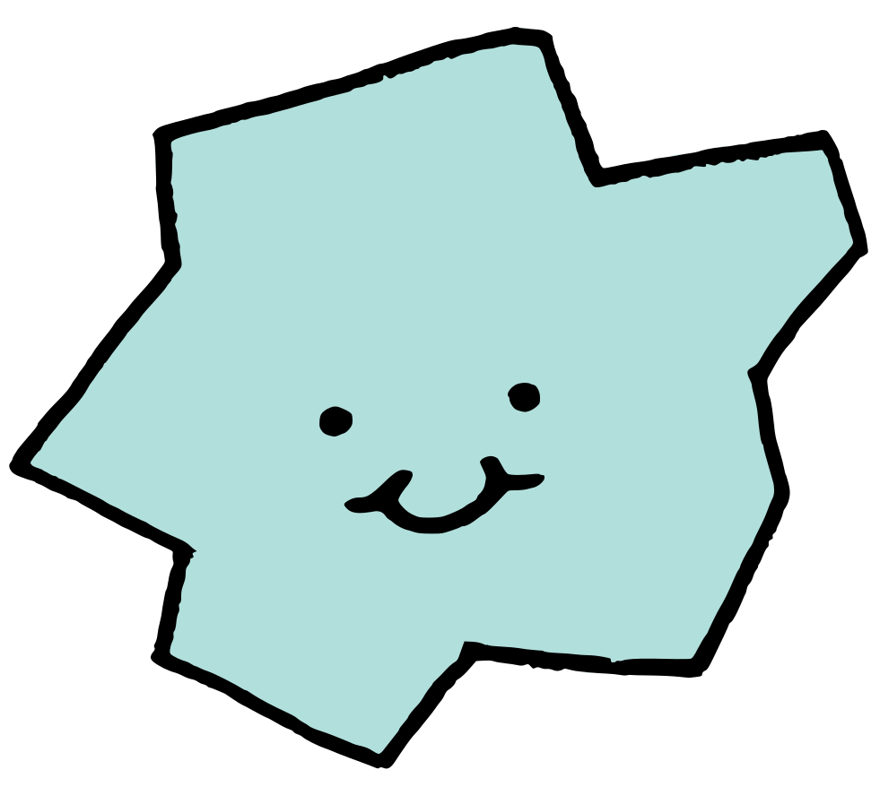
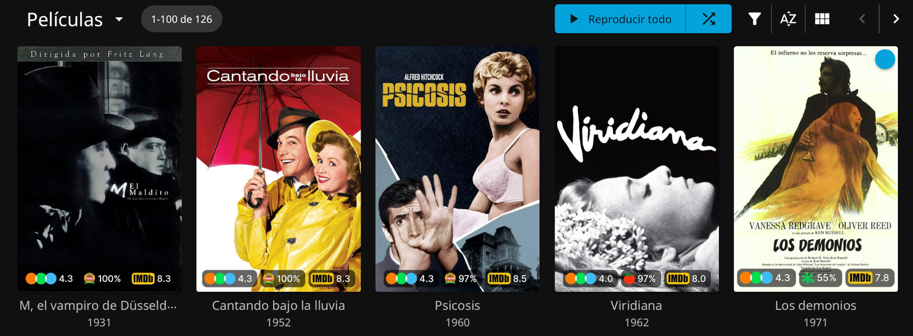
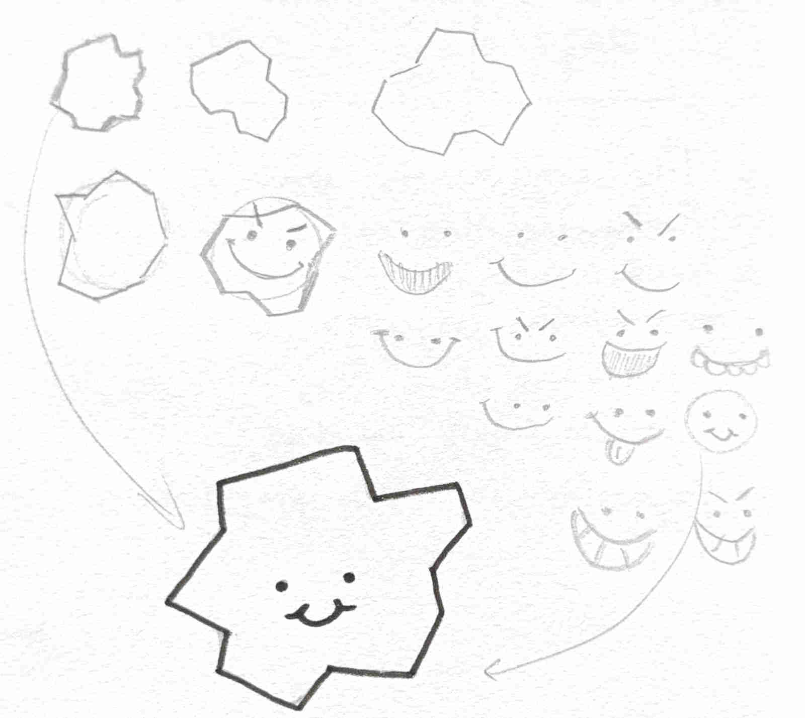

<p align="center">
  
</p>

<h1 align="center">Kometka</h1>

<p align="center"><em>Add ratings to your Jellyfin catalog</em></p>

<p align="center">
  <a href="#how-it-works">How it works</a> ·
  <a href="#requirements">Requirements</a> ·
  <a href="#installation">Installation</a> ·
  <a href="#configuration">Configuration</a> ·
  <a href="#useful-commands">Useful commands</a> ·
  <a href="#credits-and-licensing-stuff">Credits and licensing</a> ·
  <a href="#authorship-disclaimer">Authorship disclaimer</a>
</p>

Kometka is a small app whose only purpose is to add ratings to your Jellyfin catalog. The ratings are overlaid on the posters themselves. Because it's sort of a tiny [Kometa](https://github.com/Kometa-Team/Kometa)-inspired app I have decided to call it Kometka (a *small* comet).



## How it works

- Kometka keeps a copy of every original poster just in case.
- When it runs (once the first time, then daily or however you configure it) it performs a delta. Meaning, it checks what needs to be changed (unmarked movies, movies whose ratings have changed, etc.), then updates the poster through [the Jellyfin API](https://api.jellyfin.org). The ratings come from [MDBList](https://mdblist.com).
- The posters come up on every Jellyfin client (on your TV, phone, laptop...)
- Because Kometa's license allows for it, I have pulled the visual elements they use in their overlays to reproduce something as similar as possible in Jellyfin.

## Requirements

- A Jellyfin API key: *Dashboard > API Keys*.
- A free MDBList API key, for which you need to create an account: *mdblist.com > Preferences > API*.

## Installation
I would recommend using Docker to run it, rather than setting this up as a chron job. Up to you, though. 

If you do choose Docker, this is an example of what your manifest file might look like. I uploaded the image to GitHub Container Registry to make things easier for everyone.

```yaml
services:
  kometka:
    image: ghcr.io/malmriv/kometka:latest
    pull_policy: always
    container_name: kometka
    user: 1000:65000
    environment:
      - TZ=Europe/Madrid
      - JELLYFIN_URL=http://192.168.1.100:8096
      - JELLYFIN_API_KEY_FILE=/data/jellyfin.key
      - MDBLIST_API_KEY_FILE=/data/mdblist.key
      - SCHEDULE=05:00
    volumes:
      # The app will used the mapped dir to save the original posters
      # as well as your API key files and logs
      - /volume1/docker/kometka:/data
    security_opt:
      - no-new-privileges:true
    restart: unless-stopped
```

Adjust this to match your setup. (As always, if `./data` belongs to a different user, set the `user:` parameter to match). Then, depending on your backend:

- If you are using a Synology NAS like me, the Container Manager (their Docker wrapper) does everything for you: create a project and use your adapted `compose.yaml`.
- If you are using plain Docker, you can just:

```sh
docker compose up -d
docker logs -f kometka
```

If you use a different NAS or find some kind of trouble that you think should be documented, don't hesitate to contact me!

## Configuration

Besides the configuration shown in the example, you can make some small adjustments adding these environment variables to your `manifest` file.

| Variable | Default | |
|---|---|---|
| `JELLYFIN_URL` | — | Jellyfin address, reachable from the container |
| `JELLYFIN_API_KEY` | — | Or `JELLYFIN_API_KEY_FILE` |
| `MDBLIST_API_KEY` | — | Or `MDBLIST_API_KEY_FILE` |
| `SCHEDULE` | `05:00` | Daily run time |
| `RUN_ON_START` | `true` | Also run when the container starts |
| `SOURCES` | `letterboxd,rottentomatoes,imdb` | Which badges to draw, in this order |
| `LIBRARIES` | all | Comma-separated Jellyfin library names |
| `RATINGS_MAX_AGE_DAYS` | `7` | How often each movie's or series' ratings are refreshed |
| `LETTERBOXD_SCALE` | `5` | Scale for Letterboxd ratings: 5 or 10. |
| `LOG_LEVEL` | `INFO` | |

## Useful commands

```sh
docker exec kometka python -m kometka --once      # run a pass now
docker compose run --rm kometka --restore         # put the original posters back
```

## Credits and licensing stuff

Inspired by [Kometa](https://github.com/Kometa-Team/Kometa). The rating icons come from Kometa and the font is [Inter](https://github.com/rsms/inter).

Kometka is licensed under the [PolyForm Noncommercial License 1.0.0](LICENSE): use it, modify it and share it as you like, as long as it's not for commercial purposes.

The files it ships in `kometka/assets/` keep their own licenses:

| File | Source | License |
|---|---|---|
| `Letterboxd.png`, `IMDb.png`, `RT-Crit-Fresh.png`, `RT-Crit-Rotten.png`, `RT-Crit-Top.png` | [Kometa](https://github.com/Kometa-Team/Kometa), `defaults/overlays/images/rating/`, pulled from commit `fed37ea` | [MIT](kometka/assets/LICENSE-Kometa.txt) |
| `Inter-Medium.ttf` | [Inter](https://github.com/rsms/inter), as bundled with Kometa | [SIL Open Font License 1.1](kometka/assets/OFL-Inter.txt) |

The Letterboxd, IMDb and Rotten Tomatoes logos are trademarks of their respective owners.
**Kometka is not affiliated with or endorsed by Kometa, Jellyfin, MDBList or any rating service**.

## Authorship disclaimer

I actively try to use as little AI as possible, especially for personal projects. Most of the core functionality was initially hand-typed and hand-tested in a truly medieval fashion. Not because I think I can do a better job than Claude (those days are long gone), but because [leaving everything to Claude sucks the fun out of building stuff](https://blog.almag.ro/blog/being-on-the-computer-is-not-fun-anymore/). I have used help for some parts, though, and I would like to acknowledge that for transparency:

- The licensing of this repo (see above section) was chosen by Claude, since I know very little about licenses. I verified that it makes sense and kept it.
- I had never used [Pillow](https://pillow.readthedocs.io/en/stable/) (the Python library which was the most sensible option to draw the overlay on the posters), so I delegated the task on Claude. (I still have [ImageMagick](https://imagemagick.org/)-induced PTSD from my university days and I hope to never edit an image via command line ever again).
- Perform a general sanity check when the project was starting to become usable. Claude provided several useful proposals, such as turning some hard-coded choices into environment variables and actually updating the image to an image repository.
- Cleaning up the code, adding comments that could be useful for future-me.
- *Formating* this README to make it look a bit better. (The text is entirely mine, though!)

There is a long tradition of free software having [badly drawn creatures](https://en.wikipedia.org/wiki/List_of_computing_mascots) as a logo. I wanted to contribute, so I settled on a badly drawn space rock. I drew the tail-less comet by hand on a notebook, and with the invaluable help of Paula (who picked the silliest face in all of the assortment), I had a logo. It was coloured and vectorised in my computer.

<p align="center">
  
</p>